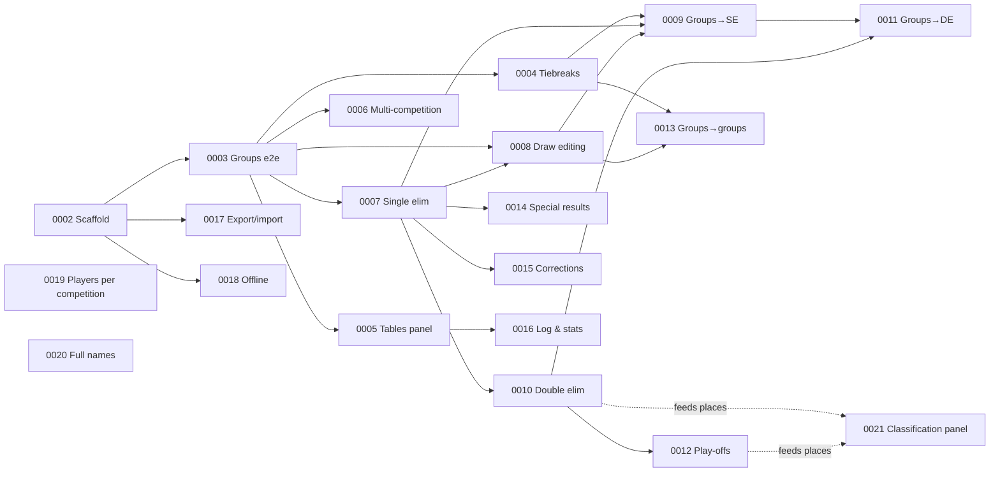

# Board

Progress of the v1 tickets (parent: [#0001 Tournament manager v1](0001-tournament-manager-v1.md)).

**How to use:**
- Pick tickets only from **Ready**.
- When you start one, move its row to **In progress** and set `status: in-progress` in the ticket.
- When it's done, move the row to **Done**, set `status: done`, and add a `## Resolution` section to the ticket.
- Then check **Blocked**: any ticket whose blockers are all Done moves to **Ready**.

## 🟢 Ready

| Ticket | Title | Blocked by |
|---|---|---|
| [#0022](0022-play-screen-ui-fixes-from-smoke-test.md) | Play screen UI fixes from the browser smoke test | none |

## 🔵 In progress

| Ticket | Title | Notes |
|---|---|---|

## ⛔ Blocked

| Ticket | Title | Blocked by |
|---|---|---|

## ✅ Done

| Ticket | Title | Resolution |
|---|---|---|
| [#0024](0024-play-offs-split-one-level-at-a-time.md) | Place play-offs split one level at a time | 4bc4e88 |
| [#0023](0023-mirrored-play-off-layout.md) | Mirrored play-off layout on the canvas | 4bc4e88 |
| [#0013](0013-groups-to-groups-with-carry-over.md) | Groups → groups with carry-over | ..9accc57 |
| [#0011](0011-groups-to-double-elimination.md) | Groups → double elimination | 56965c8 |
| [#0009](0009-groups-to-single-elimination.md) | Groups → single elimination | ..edec94a |
| [#0012](0012-place-playoffs-and-final-places.md) | Place play-offs and final places | 7a529e2, 3624827 |
| [#0014](0014-special-results-and-withdrawal.md) | Walkover, retirement, disqualification and withdrawal | c89eaa8..0e82b0a, 5268571 |
| [#0008](0008-draw-editing-before-confirm.md) | Draw editing before confirm | abf482c..b531e52 |
| [#0010](0010-direct-double-elimination.md) | Direct double elimination | f0c6fdf..d6bbd58, 46dc025 |
| [#0019](0019-register-players-per-competition.md) | Register players per competition | d7e2492, 4afbf49 |
| [#0020](0020-full-player-names-on-canvas.md) | Full player names on the canvas | 404855e, b9eafd4 |
| [#0021](0021-classification-panel.md) | Classification panel | 51398fb, c9edd69, 052cebc |
| [#0015](0015-corrections.md) | Corrections | d84cd67, 9574b95, 093a039 |
| [#0016](0016-change-log-and-stats-drawer.md) | Change log and stats drawer | 93f921a..7c947bf |
| [#0007](0007-direct-single-elimination.md) | Direct single elimination | 29ed2cf..d2f489a |
| [#0005](0005-tables-panel-overdue-and-idle.md) | Tables panel, overdue and idle | 5ba4faf..817b486 |
| [#0004](0004-ittf-tiebreaks-and-group-detail.md) | ITTF tiebreaks and group detail | a9bcfc4, 12b8ba8 |
| [#0006](0006-multiple-competitions-busy-players-waiting-list.md) | Multiple competitions: busy players and waiting-list order | e297c64, c1520e8 |
| [#0002](0002-project-scaffold-tournaments-tables-players.md) | Project scaffold: tournaments, tables and players | 58e0dfa, fb6f34b |
| [#0017](0017-export-import-and-backup-reminder.md) | Export/import and backup reminder | c9a23ce, 9086db0 |
| [#0018](0018-works-offline-pwa.md) | Works offline (PWA) | ef8ce41 |
| [#0003](0003-groups-only-competition-end-to-end.md) | Groups-only competition, end to end | 5d053a5..d86df9a |

## Dependency graph

